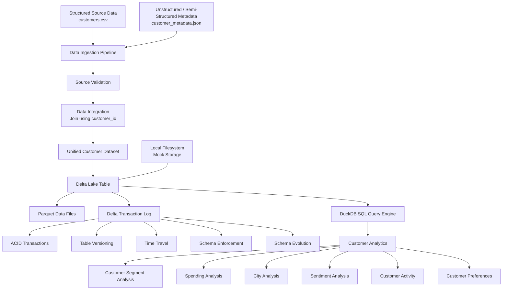

# Local Data Lakehouse Assignment

## Building a Local Data Lakehouse Using DuckDB and Delta Lake

---

## 1. Project Overview

This project demonstrates the practical implementation of a **local Data Lakehouse architecture** using open-source technologies. The objective is to understand how a data lakehouse combines the flexibility of a data lake with the analytical capabilities and data-management features traditionally associated with a data warehouse.

The project uses customer analytics data consisting of structured customer information and unstructured customer-related metadata. The two data sources are ingested, validated, combined, and stored in a unified Delta Lake table.

DuckDB is used as the analytical query engine to perform SQL-based analysis directly on the lakehouse data. Delta Lake provides transactional capabilities, table history, time travel, schema enforcement, and schema evolution.

The entire project is implemented locally using the computer's filesystem as mock lakehouse storage. This provides a practical environment for learning lakehouse concepts without requiring cloud infrastructure, paid services, or cloud credits.

### Project objectives

- Understand Data Lakehouse architecture and its purpose.
- Configure local storage to simulate a lakehouse environment.
- Work with structured and unstructured data.
- Generate sample customer datasets.
- Ingest and combine multiple data sources.
- Store unified data using Delta Lake.
- Perform analytical queries using DuckDB.
- Demonstrate ACID transactions.
- Understand Delta Lake transaction history and versioning.
- Demonstrate Time Travel.
- Demonstrate schema evolution.
- Validate data and table integrity.
- Analyze customer behavior and business metrics.

---

## 2. Technologies Used

| Technology                 | Purpose                                                                                    |
| -------------------------- | ------------------------------------------------------------------------------------------ |
| Python                     | Main programming language used to implement the pipeline and scripts                       |
| DuckDB                     | Lightweight analytical database and SQL query engine                                       |
| Delta Lake                 | Open table format providing transactions, table versioning, history, and schema management |
| delta-rs / deltalake       | Python implementation and API for interacting with Delta Lake                              |
| Pandas                     | Data manipulation, merging, validation, and analytical processing                          |
| PyArrow                    | Columnar data representation and integration with Parquet and Delta Lake                   |
| Parquet                    | Columnar storage format used for the physical data files                                   |
| JSON                       | Storage format for customer metadata and freeform text information                         |
| CSV                        | Structured source-data format                                                              |
| pytest                     | Python testing framework installed for project testing                                     |
| Python Virtual Environment | Isolated environment for project dependencies                                              |
| Local Filesystem           | Mock storage environment representing lakehouse storage                                    |

### Technology selection

DuckDB was selected because it is lightweight, easy to run locally, and capable of performing analytical SQL queries directly against files and supported table formats.

Delta Lake was selected because it adds transaction management, data versioning, historical snapshots, schema enforcement, and schema evolution capabilities to data stored in Parquet files.

This combination makes it possible to build and experiment with lakehouse functionality without deploying a distributed Spark cluster.

---

## 3. What Is a Data Lakehouse?

A Data Lakehouse is an architectural approach that combines characteristics of a Data Lake and a Data Warehouse.

### Data Lake

A Data Lake stores large amounts of data in its original or near-original formats.

It can store:

- Structured data
- Semi-structured data
- Unstructured data
- CSV files
- JSON files
- Parquet files
- Text
- Images
- Logs
- Events

A traditional Data Lake provides flexible storage, but it may lack strong transactional management, reliable table structures, and consistent data-management capabilities.

### Data Warehouse

A Data Warehouse is designed primarily for analytical workloads.

It commonly provides:

- Structured data models
- SQL querying
- Data transformation
- Business reporting
- Aggregations
- Historical analysis
- Data quality controls

Traditional warehouses are generally more structured and controlled but may require data to be transformed into specific formats before being stored and analyzed.

### Data Lakehouse

A Data Lakehouse combines the storage flexibility of a Data Lake with important management and analytical features associated with Data Warehouses.

A Lakehouse can provide:

- Flexible storage
- Structured and unstructured data support
- Open file formats
- Transaction management
- ACID properties
- Schema enforcement
- Schema evolution
- Data versioning
- Historical snapshots
- Time Travel
- SQL analytics
- Support for BI and data science workloads

The purpose of a Lakehouse is to create a unified data platform where different types of data can be stored and managed while supporting reliable analytical processing.

---

## 4. Data Lake vs Data Warehouse vs Data Lakehouse

| Feature               | Data Lake                                 | Data Warehouse       | Data Lakehouse                                           |
| --------------------- | ----------------------------------------- | -------------------- | -------------------------------------------------------- |
| Data types            | Structured, semi-structured, unstructured | Primarily structured | Structured, semi-structured, unstructured                |
| Storage flexibility   | High                                      | More structured      | High                                                     |
| Schema management     | Often limited or external                 | Strong               | Strong through table formats                             |
| Transaction support   | Not always available                      | Generally available  | Available through table formats                          |
| ACID properties       | Limited depending on implementation       | Usually supported    | Supported through open table formats                     |
| SQL analytics         | Possible depending on tools               | Strong               | Strong                                                   |
| Data science support  | Strong                                    | Possible             | Strong                                                   |
| Historical versioning | Often limited                             | Platform dependent   | Supported by table formats                               |
| Schema evolution      | Possible but may be difficult to manage   | Platform dependent   | Supported                                                |
| File-based storage    | Common                                    | Platform dependent   | Common                                                   |
| Open formats          | Frequently used                           | Varies               | Commonly emphasized                                      |
| BI support            | Requires analytical tools                 | Strong               | Strong                                                   |
| ML support            | Strong                                    | Possible             | Strong                                                   |
| Data governance       | Depends on architecture                   | Strong               | Can be implemented through metadata and table management |

---

## 5. Why Delta Lake?

Parquet is an efficient columnar storage format, but Parquet files alone do not provide complete table-level transactional management.

Delta Lake adds a transaction log and metadata layer on top of Parquet data files.

This provides capabilities such as:

- ACID transactions
- Reliable updates
- Deletes
- Data versioning
- Transaction history
- Time Travel
- Schema enforcement
- Schema evolution
- Consistent table snapshots

### Parquet

Parquet is a columnar file format.

Instead of storing complete records row by row, data is organized by columns.

This is beneficial for analytical workloads because analytical queries often select only a subset of columns.

For example, a query may need:

- Customer ID
- City
- Total spend

A columnar format can allow analytical engines to avoid reading unnecessary columns, reducing data access and improving query efficiency.

### Delta Lake

Delta Lake uses Parquet files for the physical data storage and maintains a transaction log to manage table operations.

The transaction log records operations such as:

- Initial table creation
- Data writes
- Updates
- Deletes
- Schema changes
- File additions
- File removals
- Table versions

The Delta transaction log makes it possible for the table to maintain reliable snapshots even when data changes over time.

---

## 6. Project Use Case

### Customer Analytics Lakehouse

The project uses a customer analytics scenario.

The goal is to combine customer profile information with customer feedback, support information, preferences, and marketing metadata.

The resulting dataset can be used to analyze:

- Customer demographics
- Customer segments
- Customer spending
- Customer order behavior
- Customer activity
- Customer sentiment
- Customer preferences
- Customer support information
- Customer lifetime value classifications

### Data sources

The project uses two source datasets.

#### Structured customer data

Stored in CSV format.

Contains information such as:

- Customer ID
- First name
- Last name
- Age
- Email
- City
- Country
- Customer segment
- Signup date
- Total orders
- Total spend
- Active status

#### Customer metadata

Stored in JSON format.

Contains customer-related text and metadata such as:

- Customer ID
- Feedback
- Support notes
- Preferences
- Marketing notes
- Sentiment

The two datasets share the customer ID field, which is used to combine the data.

---

## 7. Data Sources and Data Structure

### Structured dataset

The structured dataset contains 100 synthetic customer records.

The data is organized into clearly defined columns.

| Column           | Description                                   |
| ---------------- | --------------------------------------------- |
| customer_id      | Unique identifier for the customer            |
| first_name       | Customer's first name                         |
| last_name        | Customer's last name                          |
| age              | Customer age                                  |
| email            | Customer email address                        |
| city             | Customer city                                 |
| country          | Customer country                              |
| customer_segment | Customer classification                       |
| signup_date      | Customer registration date                    |
| total_orders     | Number of orders associated with the customer |
| total_spend      | Total customer spending                       |
| is_active        | Indicates whether the customer is active      |

### Unstructured customer metadata

The metadata dataset contains customer-related text information.

| Column          | Description                                          |
| --------------- | ---------------------------------------------------- |
| customer_id     | Customer identifier used to match structured records |
| feedback        | Freeform customer feedback                           |
| support_notes   | Customer support information                         |
| preferences     | Customer interests and preferences                   |
| marketing_notes | Marketing-related observations                       |
| sentiment       | Customer sentiment classification                    |

Although JSON is a semi-structured format, the text fields inside the metadata represent freeform customer information. This demonstrates the integration of structured customer records with text-based metadata.

### Synthetic dataset

The dataset is generated for educational and demonstration purposes.

It does not represent actual customer records.

The dataset contains:

- 100 customers
- Unique customer identifiers
- Multiple customer segments
- Different geographical locations
- Different spending levels
- Different order counts
- Customer feedback
- Customer support notes
- Customer preferences
- Customer sentiment

---

## 8. Project Folder Structure

The project is organized into configuration, source data, storage layers, scripts, testing, documentation, and utility directories.

```text
data-lakehouse-assignment/
│
├── .venv/
│
├── config/
│   └── settings.py
│
├── data/
│   ├── source/
│   │   ├── structured/
│   │   │   └── customers.csv
│   │   │
│   │   └── unstructured/
│   │       └── customer_metadata.json
│   │
│   ├── bronze/
│   ├── silver/
│   └── gold/
│
├── lakehouse/
│   ├── customer_delta_table/
│   │   ├── data files
│   │   └── _delta_log/
│   │
│   └── schema_evolution_demo/
│       ├── data files
│       └── _delta_log/
│
├── scripts/
│   ├── generate_dataset.py
│   ├── ingest_to_delta.py
│   ├── query_lakehouse.py
│   ├── acid_update.py
│   ├── verify_acid_update.py
│   ├── time_travel.py
│   ├── schema_evolution.py
│   └── verify_schema_evolution.py
│
├── tests/
│
├── docs/
│
├── logs/
│
├── .gitignore
│
└── requirements.txt
```

### Folder descriptions

| Folder/File                | Purpose                                                             |
| -------------------------- | ------------------------------------------------------------------- |
| `.venv`                    | Isolated Python environment                                         |
| `config`                   | Centralized project configuration and path definitions              |
| `data/source/structured`   | Structured source data                                              |
| `data/source/unstructured` | Customer metadata and text information                              |
| `data/bronze`              | Reserved for raw ingestion-stage data                               |
| `data/silver`              | Reserved for cleaned and validated data                             |
| `data/gold`                | Reserved for business-ready analytical data                         |
| `lakehouse`                | Local Delta Lake tables                                             |
| `scripts`                  | Dataset generation, ingestion, analytics, updates, and verification |
| `tests`                    | Testing and validation components                                   |
| `docs`                     | Project documentation and supporting material                       |
| `logs`                     | Application and execution logs                                      |
| `.gitignore`               | Defines files and directories excluded from Git                     |
| `requirements.txt`         | Project Python dependencies                                         |

---

## 9. Architecture Overview

The project simulates a local Data Lakehouse architecture.

The local filesystem acts as mock object storage. Delta Lake manages table metadata and transaction history on top of the Parquet data files.

DuckDB accesses the Delta Lake table for analytical SQL queries.

### Architecture diagram



### Architecture explanation

#### 1. Source layer

The project begins with two source datasets:

- Structured customer records
- Customer metadata and text information

#### 2. Ingestion layer

The ingestion process reads the source files, validates the data, and combines the datasets using the customer identifier.

#### 3. Unified dataset

The structured and metadata information is combined into one customer dataset.

#### 4. Delta Lake storage layer

The unified dataset is stored as a Delta Lake table.

The physical data is stored in Parquet files, while the Delta transaction log manages table operations and versions.

#### 5. Metadata and transaction layer

The transaction log provides information about table changes and supports:

- ACID transactions
- Historical versions
- Time Travel
- Schema management

#### 6. Analytical layer

DuckDB is used to query the Delta table using SQL.

Analytical queries generate insights about:

- Customers
- Spending
- Orders
- Customer segments
- Geography
- Sentiment
- Preferences

#### 7. Local storage

The project uses local filesystem storage as a mock lakehouse storage environment.

The same general architectural pattern can be adapted to cloud object storage in larger implementations.

---

## 10. Data Lakehouse Storage Layers

The project folder structure includes Bronze, Silver, and Gold directories to represent the common layered architecture used in data engineering.

### Bronze layer

The Bronze layer represents raw ingested data.

Its purpose is to preserve source data as it arrives.

Typical characteristics:

- Raw source records
- Minimal transformation
- Source preservation
- Initial ingestion metadata
- Traceability

In this project, the original CSV and JSON source datasets are retained under the source directory.

### Silver layer

The Silver layer represents cleaned and validated data.

Typical transformations include:

- Data cleaning
- Type validation
- Duplicate detection
- Missing-value handling
- Standardization
- Data integration
- Referential validation

The unified customer data created during ingestion demonstrates important Silver-layer processing concepts.

### Gold layer

The Gold layer represents business-ready data.

Typical characteristics:

- Aggregated data
- Business metrics
- Analytical models
- Reporting datasets
- Customer insights
- Business-specific transformations

The DuckDB analytical queries in this project demonstrate the use of the unified lakehouse data for analytical purposes.

### Note about implementation scope

The project uses the Bronze, Silver, and Gold folder structure to represent the layered architecture.

The practical implementation primarily focuses on source ingestion, unified Delta Lake storage, transaction management, and SQL analytics rather than implementing a complete production-style multi-layer transformation pipeline.

---

## 11. Environment Setup

### Prerequisites

The following tools were used:

- Windows operating system
- Python 3.12
- Visual Studio Code
- PowerShell
- Git, optionally for repository management

### Python environment

A Python virtual environment was created to isolate the project's dependencies from other Python installations.

The virtual environment helps:

- Avoid dependency conflicts
- Maintain project-specific packages
- Reproduce the environment
- Keep installations organized

### Dependency management

Project dependencies are maintained in `requirements.txt`.

The main packages used include:

- DuckDB
- deltalake
- Pandas
- PyArrow
- pytest

The project uses a local Python environment rather than a cloud environment.

### Installation workflow

The setup process consists of:

1. Creating the project directory.
2. Creating the Python virtual environment.
3. Activating the environment.
4. Installing the project dependencies.
5. Creating the required folder structure.
6. Configuring project paths.
7. Generating the sample dataset.

The installation and setup were completed locally.

---

## 12. Configuration Management

The project contains a central configuration file.

Its purpose is to manage:

- Project root directory
- Data directory
- Source directory
- Structured source directory
- Unstructured source directory
- Bronze directory
- Silver directory
- Gold directory
- Lakehouse directory
- Delta table location
- Scripts directory
- Tests directory
- Documentation directory
- Logs directory
- Project name
- Table name
- Dataset name
- Sample record count
- Random seed

Centralized configuration avoids repeatedly defining project paths throughout the implementation.

It also makes the project easier to maintain and modify.

---

## 13. Dataset Generation

A synthetic customer dataset was generated for the project.

The dataset generation process creates customer profiles and customer metadata.

### Structured dataset generation

The structured dataset includes:

- Customer identifiers
- Personal profile fields
- Demographic information
- Geographical information
- Customer segments
- Signup dates
- Order counts
- Spending amounts
- Activity status

### Metadata generation

The metadata dataset includes:

- Customer feedback
- Support notes
- Customer preferences
- Marketing notes
- Sentiment classifications

### Random seed

A random seed is used to make the dataset generation reproducible.

This means the generator can produce consistent results during repeated demonstrations when the same random seed and generation logic are used.

### Generated dataset statistics

| Dataset                                | Records |
| -------------------------------------- | ------: |
| Structured customer data               |     100 |
| Customer metadata                      |     100 |
| Unique customer IDs                    |     100 |
| Duplicate customer IDs                 |       0 |
| Matching customer IDs between datasets |     100 |

The generated data was validated before ingestion.

---

## 14. Data Validation Before Ingestion

Validation is an important component of a data engineering pipeline.

Before combining the datasets, the following validations were performed.

### Record count validation

Confirmed that the structured dataset contains 100 records and the metadata dataset contains 100 records.

### Unique identifier validation

Confirmed that customer IDs are unique in both datasets.

### Duplicate validation

Confirmed that duplicate customer IDs were not present.

### Key matching validation

Confirmed that the customer identifiers in the structured dataset match the identifiers in the metadata dataset.

### Source validation result

| Validation               | Result |
| ------------------------ | ------ |
| Structured record count  | Passed |
| Metadata record count    | Passed |
| Structured ID uniqueness | Passed |
| Metadata ID uniqueness   | Passed |
| Duplicate ID check       | Passed |
| Matching customer IDs    | Passed |
| Source validation        | Passed |

These validations ensure that the two datasets can be combined correctly.

---

## 15. Data Ingestion Pipeline

The ingestion pipeline reads both source datasets and integrates them into a unified customer dataset.

### Ingestion workflow

1. Read structured customer records from CSV.
2. Read customer metadata from JSON.
3. Validate the source records.
4. Check customer identifiers.
5. Validate uniqueness.
6. Validate matching customer IDs.
7. Combine the datasets using customer ID.
8. Add an ingestion timestamp.
9. Convert the unified data into a columnar representation.
10. Write the unified dataset to Delta Lake.
11. Validate the resulting Delta table.

### Data integration

The datasets are combined using the customer ID.

The customer ID acts as the common key between the structured customer information and the metadata.

The integration process creates a unified customer record containing both profile information and text-based metadata.

### Ingestion timestamp

An ingestion timestamp is added to the unified dataset.

This records when the data was processed and ingested into the lakehouse.

Ingestion timestamps are useful for:

- Data lineage
- Pipeline auditing
- Tracking data arrival
- Monitoring ingestion activity
- Identifying when records entered the system

---

## 16. Unified Delta Lake Table

The final unified Delta Lake table is stored locally.

### Table details

| Property              | Value              |
| --------------------- | ------------------ |
| Table name            | customer_lakehouse |
| Storage format        | Delta Lake         |
| Physical data format  | Parquet            |
| Initial Delta version | 0                  |
| Records               | 100                |
| Columns               | 18                 |
| Storage location      | Local filesystem   |
| Data compression      | Snappy             |
| Initial transaction   | WRITE              |

### Unified schema

The unified table contains the following columns:

| Column              | Data type | Description                       |
| ------------------- | --------- | --------------------------------- |
| customer_id         | String    | Unique customer identifier        |
| first_name          | String    | Customer first name               |
| last_name           | String    | Customer last name                |
| age                 | Integer   | Customer age                      |
| email               | String    | Customer email                    |
| city                | String    | Customer city                     |
| country             | String    | Customer country                  |
| customer_segment    | String    | Customer segment                  |
| signup_date         | String    | Customer signup date              |
| total_orders        | Integer   | Customer order count              |
| total_spend         | Double    | Customer total spend              |
| is_active           | Boolean   | Customer active status            |
| feedback            | String    | Customer feedback text            |
| support_notes       | String    | Support-related notes             |
| preferences         | String    | Customer preference information   |
| marketing_notes     | String    | Marketing-related notes           |
| sentiment           | String    | Customer sentiment classification |
| ingestion_timestamp | Timestamp | Data ingestion timestamp          |

### Table validation

The initial Delta table was verified.

| Validation           | Result |
| -------------------- | ------ |
| Table creation       | Passed |
| Record count         | 100    |
| Column count         | 18     |
| Delta version        | 0      |
| Schema validation    | Passed |
| Data file validation | Passed |
| Transaction history  | Passed |

---

## 17. Parquet Storage

Parquet is a columnar storage format.

The Delta Lake table uses Parquet files for its physical data storage.

### Columnar storage

Columnar storage organizes data by column rather than storing complete records sequentially.

For analytical workloads, this can be beneficial because queries often use only a small number of columns.

For example, an analytical query might only require:

- Customer ID
- Customer city
- Total spend

The query engine may be able to read the required columns without processing every column in the dataset.

### Advantages of Parquet

- Efficient analytical reads
- Column pruning
- Compression
- Reduced storage consumption
- Support for complex data types
- Compatibility with multiple analytical tools
- Open storage format

### Delta Lake and Parquet relationship

Parquet stores the physical data.

Delta Lake manages the table and its transactional metadata.

The Delta transaction log helps determine which data files belong to the current table snapshot.

---

## 18. DuckDB Integration

DuckDB was used as the analytical query engine.

It allows SQL queries to be executed locally without deploying a database server.

### Why DuckDB?

DuckDB is useful for:

- Analytical SQL queries
- Aggregations
- Data exploration
- Local data analysis
- Working with Parquet
- Querying supported table formats
- Lightweight analytics
- Data engineering experimentation

### DuckDB workflow

The project:

1. Connects to DuckDB.
2. Loads the Delta Lake functionality.
3. Reads the Delta Lake table.
4. Creates a queryable analytical view.
5. Executes SQL queries.
6. Displays analytical results.

### SQL analytics

DuckDB was used to execute multiple analytical queries against the customer lakehouse table.

The queries analyze:

- Overall customer statistics
- Customer segments
- City-level metrics
- Spending by customer segment
- Active and inactive customers
- Sentiment distribution
- Top customers
- Negative sentiment by city
- Customer preferences
- Sentiment by segment

This demonstrates that the lakehouse data can be used directly for analytical workloads.

---

## 19. Analytical Queries and Business Questions

The analytical layer answers several business questions.

### 1. Overall customer summary

Questions answered:

- How many customers are present?
- How many orders do customers have in total?
- What is the total customer spending?
- What is the average customer spending?
- What is the average number of orders per customer?

### 2. Customer segment analysis

Questions answered:

- How many customers belong to each segment?
- What percentage of customers belongs to each segment?
- Which segments contain the most customers?

### 3. City analysis

Questions answered:

- How many customers are present in each city?
- How much spending is associated with each city?
- How many orders are associated with each city?

### 4. Spending by customer segment

Questions answered:

- Which customer segment generates the highest spending?
- What is the average spending per customer in each segment?
- How many orders does each segment generate?
- How valuable are different customer segments?

### 5. Active customer analysis

Questions answered:

- How many customers are active?
- How many customers are inactive?
- What percentage of customers are active?

### 6. Sentiment analysis

Questions answered:

- How many customers have positive sentiment?
- How many customers have neutral sentiment?
- How many customers have negative sentiment?

### 7. High-value customer analysis

Questions answered:

- Who are the highest-spending customers?
- Which customer segments are represented among high-value customers?
- What is the relationship between order count and customer spending?

### 8. Negative sentiment by city

Questions answered:

- Which cities have customers with negative sentiment?
- Where are customer dissatisfaction signals concentrated?
- Which geographical areas may require additional customer support attention?

### 9. Customer preferences

Questions answered:

- What preferences are represented in the customer dataset?
- Which interests appear most frequently?
- What customer interests may be useful for marketing segmentation?

### 10. Sentiment by customer segment

Questions answered:

- How is sentiment distributed across customer segments?
- Which customer segments have more negative sentiment?
- Which segments have more positive sentiment?

---

## 20. Analytical Results

The following results were obtained from the generated dataset.

Because the data is synthetic, these results are intended for learning and demonstration rather than representing real business performance.

### Overall customer statistics

| Metric                      |        Result |
| --------------------------- | ------------: |
| Total customers             |           100 |
| Total orders                |         1,325 |
| Total customer spend        | ₹7,155,658.21 |
| Average spend per customer  |    ₹71,556.58 |
| Average orders per customer |         13.25 |

### Customer segment distribution

| Segment  | Customers | Percentage |
| -------- | --------: | ---------: |
| Basic    |        34 |        34% |
| Standard |        32 |        32% |
| Premium  |        23 |        23% |
| VIP      |        11 |        11% |
| Total    |       100 |       100% |

### Spending by customer segment

| Segment  | Customers |   Total Spend | Average Spend per Customer | Average Orders |
| -------- | --------: | ------------: | -------------------------: | -------------: |
| VIP      |        11 | ₹3,719,268.87 |                ₹338,115.35 |          40.82 |
| Premium  |        23 | ₹2,197,857.12 |                 ₹95,559.01 |          20.83 |
| Standard |        32 |   ₹979,174.68 |                 ₹30,599.21 |           9.38 |
| Basic    |        34 |   ₹259,357.54 |                  ₹7,628.16 |           2.85 |

### Key segment insight

VIP customers represent only 11% of the customer population but contribute approximately 52% of total spending.

This demonstrates how customer segmentation can help identify high-value customer groups.

### Active customer distribution

| Status   | Customers | Percentage |
| -------- | --------: | ---------: |
| Active   |        80 |        80% |
| Inactive |        20 |        20% |
| Total    |       100 |       100% |

### Sentiment distribution

| Sentiment | Customers | Percentage |
| --------- | --------: | ---------: |
| Neutral   |        36 |        36% |
| Negative  |        33 |        33% |
| Positive  |        31 |        31% |
| Total     |       100 |       100% |

### Customer preferences

The preference analysis identified the following interest categories:

| Interest    | Customers |
| ----------- | --------: |
| Fashion     |        31 |
| Accessories |        30 |
| Beauty      |        29 |
| Gaming      |        27 |
| Electronics |        22 |
| Sports      |        21 |

### High-value customer observations

The top 10 spending customers in the generated dataset were all classified as VIP customers.

This demonstrates how customer segments can be used to identify customers with significant spending activity.

### Negative sentiment by city

The analysis identified negative sentiment across several cities.

The highest counts included:

| City      | Negative Sentiment Customers |
| --------- | ---------------------------: |
| Gurugram  |                            5 |
| Panchkula |                            4 |
| Jaipur    |                            4 |
| Bengaluru |                            4 |
| Ahmedabad |                            3 |
| Hyderabad |                            3 |
| Indore    |                            2 |
| Kolkata   |                            2 |
| Mumbai    |                            2 |
| Delhi     |                            2 |

This analysis can be used to identify locations that may require further customer experience investigation.

---

## 21. ACID Transactions

ACID is a set of properties used to describe reliable database transactions.

Delta Lake supports ACID transaction behavior through its transaction log and table-management mechanism.

### A — Atomicity

Atomicity means a transaction is treated as a complete operation.

A transaction should either be committed successfully or not committed.

In the project, the customer update was committed as a Delta transaction.

The operation was recorded in the transaction history.

### C — Consistency

Consistency means that a transaction maintains the expected rules and integrity of the data.

In this project, validations ensured that:

- The total number of customers remained consistent.
- The table schema remained valid.
- The customer update was applied correctly.
- The updated customer record could be retrieved.

### I — Isolation

Isolation means that concurrent transactions should not interfere with one another in an invalid manner.

Delta Lake manages table operations through its transaction mechanism, helping maintain consistent table snapshots.

### D — Durability

Durability means that once a transaction is committed, its result is recorded and remains available.

The update was committed to Delta Lake and verified by reading the table after the operation.

### ACID update demonstration

The project updated customer `CUST-1001`.

#### Before the update

| Column        | Value                                                      |
| ------------- | ---------------------------------------------------------- |
| Customer ID   | CUST-1001                                                  |
| Sentiment     | Negative                                                   |
| Support notes | Customer requested clarification regarding payment status. |

#### After the update

| Column        | Value                                                                               |
| ------------- | ----------------------------------------------------------------------------------- |
| Customer ID   | CUST-1001                                                                           |
| Sentiment     | Positive                                                                            |
| Support notes | Support issue resolved successfully. Customer received assistance and confirmation. |

### Update transaction results

| Metric                     | Result |
| -------------------------- | -----: |
| Updated records            |      1 |
| Added files                |      1 |
| Removed files              |      1 |
| Copied rows                |     99 |
| Total records after update |    100 |
| Delta version after update |      1 |

The update was successfully committed and verified.

---

## 22. Delta Lake Transaction History

Delta Lake maintains a transaction history for table operations.

The history records information such as:

- Operation type
- Operation parameters
- Transaction version
- Timestamp
- Added files
- Removed files
- Updated rows
- Engine information

### Main customer table history

| Version   | Operation | Description                |
| --------- | --------- | -------------------------- |
| Version 0 | WRITE     | Initial table creation     |
| Version 1 | UPDATE    | Customer CUST-1001 updated |

### Why transaction history is important

Transaction history provides visibility into changes made to the table.

It can be useful for:

- Auditing
- Debugging
- Investigating data changes
- Tracking operations
- Understanding table evolution
- Recovering historical information

---

## 23. Delta Lake Time Travel

Time Travel allows a user to query a table as it existed at a previous version.

Instead of reading only the current table snapshot, users can access historical versions.

### Time Travel demonstration

The project created two versions of the main customer Delta table.

| Version   | Description                |
| --------- | -------------------------- |
| Version 0 | Original customer table    |
| Version 1 | Customer CUST-1001 updated |

### Version 0

Customer CUST-1001:

- Sentiment: Negative
- Support notes: Customer requested clarification regarding payment status.

### Version 1

Customer CUST-1001:

- Sentiment: Positive
- Support notes: Support issue resolved successfully. Customer received assistance and confirmation.

### Time Travel validation

Both historical snapshots were successfully retrieved.

| Validation                | Result   |
| ------------------------- | -------- |
| Version 0 retrieval       | Passed   |
| Version 1 retrieval       | Passed   |
| Version 0 record count    | 100      |
| Version 1 record count    | 100      |
| Historical sentiment      | Negative |
| Updated sentiment         | Positive |
| Time Travel demonstration | Passed   |

### Benefits of Time Travel

Time Travel can be useful for:

- Auditing historical data
- Investigating data changes
- Comparing snapshots
- Debugging analytical results
- Reproducing previous reporting states
- Understanding the impact of data updates
- Recovering historical information

---

## 24. Schema Enforcement

Schema enforcement is the process of ensuring that incoming data follows the expected structure and data types of a table.

A table schema defines:

- Column names
- Data types
- Column structure
- Data organization

Schema enforcement helps prevent unexpected or incompatible data from being introduced into a table.

### Schema enforcement in this project

The initial customer Delta table was created with a defined schema.

The unified dataset was validated before being written to Delta Lake.

The resulting Delta table was verified to contain the expected columns and data types.

The schema validation confirmed:

- Expected customer columns
- Correct data types
- Valid record count
- Valid table structure

---

## 25. Schema Evolution

Schema evolution allows the schema of a table to change as business requirements evolve.

For example, a customer analytics table may initially contain basic customer information.

Later, a business may decide to introduce:

- Customer lifetime value classifications
- Loyalty information
- Customer risk scores
- Marketing categories
- New demographic fields
- Additional customer attributes

Schema evolution allows a table to accommodate such changes.

### Schema evolution demonstration

The project created a separate Delta Lake demonstration table.

The original schema contained 18 columns.

A new column was introduced:

`customer_lifetime_value_band`

The new column classifies customers based on total spending.

### Customer lifetime value classification

| Spending range             | Classification |
| -------------------------- | -------------- |
| Below ₹25,000              | Low            |
| ₹25,000 to below ₹100,000  | Medium         |
| ₹100,000 to below ₹250,000 | High           |
| ₹250,000 or above          | VIP            |

### Schema evolution results

| Version   | Columns | Records |
| --------- | ------: | ------: |
| Version 0 |      18 |     100 |
| Version 1 |      19 |     100 |

### Classification results

| Classification | Customers |
| -------------- | --------: |
| Low            |        46 |
| Medium         |        31 |
| High           |        14 |
| VIP            |         9 |
| Total          |       100 |

### New column

The evolved schema contains:

| Column                       | Description                            |
| ---------------------------- | -------------------------------------- |
| customer_lifetime_value_band | Spending-based customer classification |

### Schema evolution validation

| Validation                    | Result     |
| ----------------------------- | ---------- |
| Initial schema                | 18 columns |
| Evolved schema                | 19 columns |
| New column present            | Passed     |
| Record count preserved        | Passed     |
| Classification values valid   | Passed     |
| Delta version                 | Version 1  |
| Schema evolution verification | Passed     |

### Schema evolution vs. table versioning

These concepts are related but different.

**Table versioning** records changes to table snapshots and transactions.

**Schema evolution** changes the structure of the table, such as adding a column.

The project demonstrated both:

- Table versioning through the initial write and update.
- Schema evolution through the addition of the customer lifetime value classification column.

---

## 26. Verification and Validation

Validation was performed throughout the implementation.

### Source dataset validation

- Record counts
- Unique identifiers
- Duplicate checks
- Matching customer IDs
- Structured and metadata dataset consistency

### Ingestion validation

- Successful source reading
- Successful dataset integration
- Record count
- Column count
- Delta table creation
- Schema verification

### ACID update validation

- Customer update
- Updated sentiment
- Updated support notes
- Record count preservation
- Column count preservation
- Delta version verification
- Transaction history verification

### Time Travel validation

- Historical Version 0 retrieval
- Current Version 1 retrieval
- Record count validation
- Historical value validation
- Updated value validation

### Schema evolution validation

- Initial schema
- Evolved schema
- New column presence
- Record count preservation
- Valid classification values
- Delta version validation

### Analytics validation

- All analytical queries executed
- Customer counts validated
- Segment metrics generated
- Spending metrics generated
- Sentiment metrics generated
- Customer preference metrics generated

---

## 27. Project Implementation Steps

The project was completed through the following major stages.

### Step 1 — Project planning

Defined the project objectives, technology stack, use case, and required lakehouse capabilities.

### Step 2 — Environment setup

Created the local project directory and Python virtual environment.

Installed the required Python packages.

### Step 3 — Project structure

Created the project folders for:

- Configuration
- Source datasets
- Bronze
- Silver
- Gold
- Lakehouse
- Scripts
- Tests
- Documentation
- Logs

### Step 4 — Configuration

Created centralized project configuration for directories, dataset settings, and Delta Lake storage paths.

### Step 5 — Dataset generation

Generated synthetic customer records and customer metadata.

### Step 6 — Source validation

Validated record counts, uniqueness, duplicates, and matching customer IDs.

### Step 7 — Data ingestion

Read the CSV and JSON sources, integrated them, added an ingestion timestamp, and created the unified customer dataset.

### Step 8 — Delta Lake storage

Stored the unified customer dataset in Delta Lake using Parquet data files.

Verified the initial table, schema, data files, and transaction history.

### Step 9 — DuckDB integration

Connected DuckDB to the Delta Lake table and performed analytical SQL queries.

### Step 10 — Analytics

Performed customer, segment, spending, city, sentiment, activity, and preference analysis.

### Step 11 — ACID update

Updated customer CUST-1001 and verified the transaction.

### Step 12 — Time Travel

Retrieved Version 0 and Version 1 of the main customer table and compared the historical and updated values.

### Step 13 — Schema evolution

Created a separate demonstration table and introduced a new customer lifetime value classification column.

### Step 14 — Verification

Validated the ACID update, Time Travel, and schema evolution demonstrations.

---

## 28. Local Storage vs. Cloud Object Storage

This project uses local filesystem storage.

The local lakehouse directory acts as a mock object storage environment.

### Local storage implementation

The project stores:

- Delta Lake table directories
- Parquet data files
- Delta transaction logs
- Source CSV data
- Source JSON metadata

### Cloud object storage comparison

In a production cloud environment, the local storage pattern could be adapted to object storage platforms such as:

- Amazon S3
- Google Cloud Storage
- Azure Data Lake Storage

Cloud object storage provides scalable storage for large datasets.

The open table format layer can manage the table metadata and transactions on top of the storage system.

### Important project limitation

This project does not deploy or use actual cloud object storage.

It is a local simulation of the storage architecture.

No cloud infrastructure is required for the practical implementation.

---

## 29. Limitations

This project is a learning and demonstration implementation.

### Synthetic data

The dataset is generated synthetically.

It does not represent real customers or actual business transactions.

### Local storage

The lakehouse is implemented on a local filesystem rather than a cloud storage platform.

### Dataset size

The dataset contains only 100 customers.

This is sufficient for demonstrating concepts but not for performance benchmarking.

### Distributed processing

The project does not use a distributed Spark cluster.

DuckDB provides local analytical processing.

### Production deployment

The project does not include:

- Production orchestration
- Automated scheduling
- Cloud deployment
- Enterprise access control
- Production monitoring
- Data catalog integration
- Large-scale distributed ingestion
- Production data governance

### Layer implementation

The project uses the Bronze, Silver, and Gold folder structure as an architectural representation.

It does not implement a complete production-grade multi-layer transformation pipeline.

---

## 30. Future Enhancements

The project can be extended with additional capabilities.

### Data engineering enhancements

- Implement a complete Bronze, Silver, and Gold pipeline.
- Add automated ingestion scheduling.
- Implement incremental ingestion.
- Add additional source systems.
- Implement data quality frameworks.
- Add schema validation frameworks.
- Implement error handling and quarantine data.

### Lakehouse enhancements

- Implement partitioning.
- Demonstrate compaction.
- Demonstrate data cleanup and retention.
- Add additional Delta tables.
- Implement more complex schema changes.
- Explore Delta Lake optimization.

### Analytics enhancements

- Create additional analytical models.
- Build customer cohorts.
- Implement customer retention analysis.
- Calculate customer lifetime value.
- Create customer churn indicators.
- Build dashboards using Power BI or another BI tool.

### Cloud enhancements

- Migrate local storage to cloud object storage.
- Explore Google Cloud Storage.
- Explore Amazon S3.
- Explore Azure Data Lake Storage.
- Implement cloud-based processing and orchestration.

### Advanced data engineering

- Explore Apache Spark.
- Implement streaming data ingestion.
- Integrate Kafka.
- Implement event-driven ingestion.
- Explore orchestration tools.
- Implement automated data quality monitoring.

---

## 31. Key Concepts Learned

This project provided practical experience with the following concepts.

### Data Lake

Flexible storage for different types of data.

### Data Warehouse

Structured analytical storage designed for reporting and business analysis.

### Data Lakehouse

Architecture combining flexible data lake storage with analytical and transactional capabilities.

### Open Table Format

A table-management layer that provides metadata and table operations over physical data files.

### Delta Lake

A table format providing transaction management, history, versioning, Time Travel, and schema capabilities.

### Parquet

A columnar storage format optimized for analytical workloads.

### DuckDB

A lightweight analytical SQL engine.

### Structured Data

Data organized into predefined columns and types.

### Semi-Structured Data

Data stored in formats such as JSON with flexible structures.

### Data Ingestion

The process of extracting data from sources and bringing it into a data platform.

### Data Integration

Combining data from different sources.

### Data Validation

Checking data quality, consistency, completeness, and integrity.

### ACID

A set of properties used to describe reliable transaction processing.

### Atomicity

Transactions are treated as complete operations.

### Consistency

Transactions maintain expected data rules and integrity.

### Isolation

Concurrent transactions should not interfere in invalid ways.

### Durability

Committed transactions remain recorded.

### Transaction Log

Metadata used to record table operations and manage changes.

### Table Versioning

Maintaining historical table snapshots.

### Time Travel

Retrieving a table at a previous version.

### Schema Enforcement

Ensuring data follows the expected table schema.

### Schema Evolution

Allowing the table schema to change over time.

### Columnar Storage

Organizing data by columns for analytical processing.

### SQL Analytics

Using SQL to query, aggregate, and analyze datasets.

---

## 32. Final Project Summary

This project successfully demonstrates the implementation of a local Data Lakehouse using DuckDB and Delta Lake.

Synthetic customer data was generated in structured CSV and JSON formats. The two datasets were validated, integrated, and ingested into a unified Delta Lake table containing 100 customer records and 18 columns.

DuckDB was used to query the lakehouse using SQL and perform analytical operations involving customer segments, spending, geographical distribution, activity, sentiment, preferences, and high-value customers.

The project also demonstrated important Delta Lake capabilities. An ACID update was performed on a customer record and verified through transaction history. Historical snapshots were retrieved using Time Travel, allowing the original and updated customer information to be compared. Schema evolution was demonstrated by adding a customer lifetime value classification column to a separate Delta table, expanding its schema from 18 to 19 columns while preserving all 100 records.

All major practical validations completed successfully.

The implementation provides a hands-on understanding of how a Data Lakehouse combines flexible storage, open file formats, transactional metadata, historical versioning, schema management, and SQL analytics in a unified architecture.

---

## 33. Approximately 200-Word Assignment Summary

A Data Lakehouse combines the flexibility of a Data Lake with the analytical and management capabilities of a Data Warehouse. Traditional data lakes can store large amounts of structured, semi-structured, and unstructured data but may lack strong table management and transaction capabilities. Data warehouses provide structured analytical environments but can be less flexible for storing diverse data formats. A Lakehouse bridges these limitations by using open storage formats and table-management layers that support reliable analytics.

This project implemented a local Data Lakehouse using DuckDB and Delta Lake. Structured customer information was generated in CSV format, while customer feedback, support notes, preferences, marketing information, and sentiment were stored as JSON metadata. Both datasets were validated, integrated, and ingested into a unified Delta Lake table containing 100 records.

DuckDB was used to perform SQL analytics on customer spending, segments, locations, sentiment, activity, and preferences. Delta Lake capabilities were demonstrated through an ACID update, transaction history, Time Travel, and schema evolution. The project successfully showed how a Lakehouse can provide unified storage, reliable data management, historical data access, schema flexibility, and analytical processing using a local environment without requiring cloud infrastructure.

---

## 34. Final Conclusion

The practical implementation of this assignment is complete.

The project successfully demonstrates the core principles of a Data Lakehouse architecture:

- Unified storage for structured and metadata data
- Open table format
- Parquet storage
- Delta Lake transaction management
- ACID update operations
- Transaction history
- Historical versioning
- Time Travel
- Schema enforcement
- Schema evolution
- SQL-based analytics
- Data validation

The project provides a foundational understanding of how modern data engineering platforms can integrate data ingestion, storage, transformation, transaction management, and analytical processing into a unified architecture.

It also establishes a foundation for future learning and projects involving distributed data processing, cloud data lakes, Spark, streaming systems, orchestration, and production data platforms.

---

**Project:** Local Data Lakehouse Assignment  
**Primary Technologies:** Python, DuckDB, Delta Lake, Pandas, PyArrow, Parquet  
**Storage:** Local filesystem  
**Dataset:** Synthetic Customer Analytics Dataset  
**Implementation Status:** Completed  
**Major Validations:** Passed
